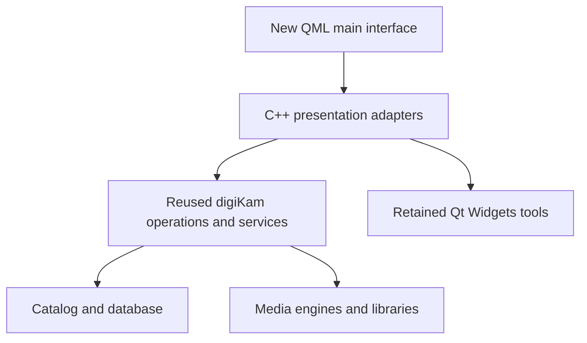

# Architecture and Reuse Strategy

Status: initial architecture baseline, 2026-10-16.

## Product direction

Deliver a modern interface for digiKam's established photo management capabilities.
The first release prioritizes a usable GUI and timely delivery. A backend rewrite,
language migration, or new storage service is outside the initial scope.

Windows, macOS, and Linux are first-phase targets. A catalog of one million items
is the design target; achieved capacity and responsiveness require measurement.

## Technology decisions

| Area | Decision |
| --- | --- |
| Application and backend | Retain C++ and follow the reference source's compiler requirements. |
| Desktop framework | Qt 6; select and pin a supported version during build bring-up. |
| New main interface | Qt Quick/QML, with Qt Quick Controls and shared design tokens. |
| Backend integration | C++ QObject services and QAbstractItemModel adapters. |
| Existing tools | Retain Qt Widgets windows where replacing them would delay the first release. |
| Database | Retain upstream schema and access logic initially; SQLite and MariaDB are the planned choices. |
| Media processing | Reuse existing RAW, metadata, color management, image processing, and video capabilities. |
| KDE dependencies | Keep dependencies needed by reused code; remove only when affected components no longer need them. |
| Build | CMake and native build/package validation on all three target platforms. |
| Rust | Not required for this implementation. |

Qt Quick is the chosen direction, but image delivery, input, backend integration,
and coexistence with retained tool windows must be validated in a working slice
before broad UI conversion. UI technology does not by itself guarantee color
accuracy or responsiveness.

## Integration boundaries

Keep SQL, filesystem traversal, image decoding, and metadata writes outside QML.
The presentation layer exposes data roles, selection state, commands, job progress,
and actionable errors. Preserve existing operation semantics through adapters.

Use existing engines for expensive work and deliver results asynchronously to the
interface. Model changes and presentation updates must respect Qt thread ownership.
Avoid creating a second database owner, scanner, or job system alongside the
existing one merely to support the new interface.

UI-only state, such as panel visibility and layout preferences, belongs to the
presentation layer. Persistent photo metadata remains owned by the existing backend.

## Reuse findings

The reference backend is not a standalone, UI-independent SDK:

- `core/app/DigikamCoreTarget.cmake` combines media, database, widget, dialog,
  and utility objects, and links Qt Widgets and KDE components.
- `core/app/DigikamGuiTarget.cmake` combines main-window code, collection
  management, views, and other application functionality.
- `core/libs/album/manager/albummanager.h` exports AlbumManager through the GUI
  library even though it provides important application behavior.
- `core/libs/database/models/itemmodel.h` provides a QAbstractListModel-based
  model, but its loading and filtering behavior still needs scale evaluation.

Extract or adapt only the boundaries required by the new interface. Preserve
necessary runtime dependencies initially. Qt Widgets-based plugin and tool UIs
will need explicit launch/context adapters; compatibility is not automatic.

Retain upstream database format and behavior where possible. This does not promise
safe simultaneous access by PhotoCarta and digiKam, or compatibility across every
upstream schema version. Use separate test catalog copies during development.

## Delivery principles

- Validate an integrated browsing slice before converting the complete main window.
- Keep backend changes narrowly tied to GUI integration or measured regressions.
- Separate required release fixes from future scale and feature improvements.
- Keep source provenance and upstream changes traceable.
- Do not claim a platform or catalog size has been validated until it has been tested.

The source import layout, exact dependency versions, minimum operating system
versions, and package formats will be settled during build bring-up. This repository
currently contains documentation, not a configured digiKam build.

## References

- [Qt Quick](https://doc.qt.io/qt-6/qtquick-index.html)
- [Qt supported platforms](https://doc.qt.io/qt-6/supported-platforms.html)
- Local digiKam source at commit `c60c45a8aa30a6a135982cfa4e46cbcaff0bc2c8`.
